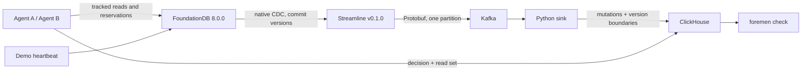

# Foremen AI

Created by [Rodrigo Munoz](https://github.com/munozr1).

An AI agent can read accurate data and still act on an outdated view seconds later. Foremen AI tracks what an agent read and shows what changed while it was thinking. In the inventory demo, two agents confirm **two orders for the last unit in stock**; enable the revision guard, and the stale reservation is rejected before the second order is created. Each finding identifies the missed write, the agent behind it, and the database versions that show what happened.

Foremen piggybacks on my friend's [Kafka-FDB-Streamline](https://github.com/Ronitsabhaya75/Kafka-FDB-Streamline) bridge to bring FoundationDB's change history into that investigation.

## Build status

**The scripted MVP is verified on the live Compose stack.** On October 30, 2026, `make test` passed 53 tests (47 offline and six live integration cases) in 10.93 seconds, followed by the bridge-restart check retaining all 75 exact mutations with no gaps. Native CDC version alignment, both race modes, the serial control, and watermark gating passed. Across 20 races, commit-to-ClickHouse visibility measured **164 ms p50 and 228 ms p95**. See the [acceptance output](docs/evidence/acceptance.txt) and [latency samples](docs/evidence/latency.json).

The optional real-agent demo also reproduced the race: two real Agents SDK agents confirmed two orders for one unit, and Foremen identified agent A's stale decision with a 4.50-second view age. See the [LLM run output](docs/evidence/llm.txt). Both decisions retained SDK trace IDs, and a separate live tracked-read check verified the `foremen.read` span and successful SDK export. See the [trace evidence](docs/evidence/sdk-trace.txt). A local Python wheel has been built; no package release has been published.

## Quickstart

Requires Docker Desktop / Docker Compose v2, Make, and Python 3.12 for the host-side restart test. Images currently target `linux/amd64`; Apple Silicon uses emulation. The services use an internal `172.29.81.0/24` network and expose no host ports.

```sh
make up
make demo-race
make demo-guarded
```

Start with `make spike` to prove a real FDB write arrives in Kafka with exactly the client's commit version. `make test` runs all offline and live acceptance tests, then stops/restarts the bridge while writes continue. No OpenAI key is needed for either command. Tests and demos share one SKU, so run them sequentially.

`make down` stops services and keeps their data. Treat the FDB, Kafka, bridge cursor, and ClickHouse volumes as one dataset; deleting only part can invalidate continuity or watermarks. Use a fresh Compose project for an independent dataset.

## Architecture



The bridge is unmodified, pinned to v0.1.0 commit `2762839b2f51d4eedf2f1a4b8e9f2770275099c4`. Its package exposes Python libraries, not a command. `foremen.bridge` supplies configuration and lifecycle handling. Official FDB 8.0.0 artifacts and its Docker tag were verified directly; the bridge's older deep-dive note claiming they are unreleased is stale. See [M0 evidence](docs/m0.md).

The sink reuses the bridge's decoder and consumes ordered batches of up to 256 Kafka records with a 0.1-second collection timeout. It validates the entire batch, inserts all mutations before any commit boundaries, then synchronously commits only the final Kafka offset. Insert/decode/offset errors stop consumption; Compose restarts the process so failed records can replay. `ReplacingMergeTree` absorbs exact offset/index redeliveries without erasing historical changes. Queries use `DISTINCT`, not `FINAL`.

The guard compares the observed `rev` to the current `rev` inside a fresh transaction and repeats that comparison on conflict retries. It never reuses an old FDB read version. The demo waits for a read version strictly after B's commit before releasing A, so the detector's strict version inequalities remain deterministic. Every inventory update, including reseeding, increments the current revision. The vulnerable write intentionally uses the old quantity while still advancing revision bookkeeping.

## Commands

| Command | Purpose |
|---|---|
| `make spike` | Native CDC key/value and commit-version equality check |
| `make demo-race` | Deterministic oversell, two orders and one stale finding |
| `make demo-guarded` | Deterministic rejection, one order and one blocked finding |
| `make demo-serial` | Serial control, one order and no findings |
| `make demo-race-llm` | Two real Agents SDK agents using the same tools |
| `make check RUN_ID=<printed-id>` | Wait up to 30 seconds and inspect a completed run |
| `make test` | Full suite, including real bridge restart and 20-run latency report |
| `make test-restart` | Standalone recovery test: 25 writes before, during, and after downtime |
| `make test-unit` | Offline tests using the local `.venv` |

The CLI returns exit code 2 if the run is unknown or the CDC watermark has not caught up. A timeout is **not** a clean verdict. Findings themselves return 0: this is an inspection command, not a CI policy gate.

Actual output from the [recorded scripted runs](docs/evidence/scripted-demos.txt):

```text
Orders confirmed: 2 for 1 unit of stock
STALE DECISION  agent-a  reserve_stock  (committed)
  read     inv/sku-1  at version 266510714
  missed   a write by agent-b at version 266527583
  decided  at version 266590864
  the view was about 0.08 s old when the decision was made

Orders confirmed: 1 for 1 unit of stock
STALE DECISION  agent-a  reserve_stock  (blocked_stale)
  read     inv/sku-1  at version 284863463
  missed   a write by agent-b at version 284879363
  decided  at version 284930428
  the view was about 0.07 s old when the decision was made
```

The two race modes are also captured in a [terminal recording](docs/evidence/demo.cast) with a [plain-text transcript](docs/evidence/recorded-demo.txt). Replay the recording with `asciinema play docs/evidence/demo.cast` if asciinema is installed.

## Optional real agents

Copy `.env.example` to `.env` and set `OPENAI_API_KEY`. `make demo-race-llm` uses `openai-agents==0.24.0` and the dated `gpt-4.1-mini-2025-04-14` model by default. Override `OPENAI_MODEL` if needed. Calls incur normal API usage. The key is passed only to the app container; `.env` is excluded from image builds and Git.

Tracing defaults off. Set `FOREMEN_TRACING=1` to enable SDK traces with `foremen.read` custom spans. `ForemenContext` stays in the tool's local context. Decisions go directly to ClickHouse whether tracing is enabled or not. LLM runs are bounded by deadlines but nondeterministic and are excluded from acceptance assertions.

The verified `FOREMEN_TRACING=1 make demo-race-llm` run was `bd29e055fede44dfa25099742e551971`. Agent A read version `1079547608`, missed agent B's write at `1081688681`, and committed at `1084045460`; Foremen printed one stale finding and two confirmed orders. The [captured output](docs/evidence/llm.txt) records the real-agent race. The [separate tracing check](docs/evidence/sdk-trace.txt) confirms an actual tracked read produced a `foremen.read` span with matching key, read version, and revision, followed by successful SDK export; it also records the trace IDs attached to both real-agent decisions.

## Verification and latency

| Acceptance check | Evidence | Live result |
|---|---|---|
| Client / stream commit-version equality | [Native CDC spike](docs/evidence/spike.txt), integration test | Passed: client and CDC version `41282230` |
| Serial control | [Scripted runs](docs/evidence/scripted-demos.txt), integration test | Passed: one order, no findings |
| Unguarded race: exactly one finding, two orders | [Scripted runs](docs/evidence/scripted-demos.txt), integration test | Passed: agent A missed agent B's write |
| Guarded race: blocked A, one order | [Scripted runs](docs/evidence/scripted-demos.txt), integration test | Passed: `blocked_stale` finding |
| Bridge restart: no missing mutations | [Acceptance output](docs/evidence/acceptance.txt), `scripts/test_restart.py` | Passed: all 75 exact mutations retained |
| Watermark gates synthetic decisions | [Acceptance output](docs/evidence/acceptance.txt), isolated ClickHouse database test | Passed |
| 20 races: commit-to-row p50 / p95, p95 < 10 seconds | [All samples](docs/evidence/latency.json) | Passed: p50 0.164 s, p95 0.228 s |

Latency is measured from the post-commit recorder callback until the matching row is observed in ClickHouse, including decision recording and polling overhead. `make test` prints all 20 samples plus median and nearest-rank p95. The measured median was **0.1643109485 s** and p95 was **0.2277220160 s**, below the 10-second acceptance limit. This measures commit-to-row visibility; it excludes model time and the detector query itself.

Offline tests exercise the real bridge serializer and checkpoint APIs with fake database/producer boundaries. The separate live bridge-restart test writes 25 mutations before downtime, 25 while the bridge is stopped, and 25 after it restarts, then verifies each exact key/version/value triple in ClickHouse. Its passing result is the MVP's recovery evidence; it does not establish production durability under every failure mode.

For local development:

```sh
python3.12 -m venv .venv
.venv/bin/python -m pip install -r requirements.lock
.venv/bin/python -m pip install --no-deps -e .
make test-unit
```

`requirements.lock` pins all resolved runtime, SDK, and test dependencies. The app image installs the matching native FDB client using its verified SHA-256 checksum. Native FDB operations run in Compose; installing the Python binding alone is insufficient on the host.

## Known limitations

- One SKU, one Kafka partition, readable UTF-8 keys, JSON inventory values, local Compose only. The fixed subnet must not overlap another Docker network.
- The read set includes every read so far. An unrelated or superseded read can cause extra findings; this is not semantic causality analysis.
- Clear-range mutations are stored but not matched. Keys an agent never read and actions that do not write to FDB are not judged. Writer attribution currently matches JSON `SET_VALUE` mutations only.
- Strict version inequalities cannot establish order between separate transactions assigned the same commit version; the guard still compares revisions.
- Every participating inventory writer must maintain the revision counter. Deleting/recreating keys with reused revisions can invalidate that guarantee.
- FDB commit and ClickHouse decision insert are separate operations. A crash or insert failure after commit can leave an unlogged write. There is no distributed transaction or decision outbox in this MVP.
- An unknown commit outcome stops reservation retries and reports the order key for reconciliation; no production idempotency protocol is provided. Do not treat this demo as an order-processing system.
- No production security, retention management, concurrent demo isolation, high availability, dashboard, or cloud deployment. Demo credentials are local defaults.
- Native CDC in FDB 8.0 is experimental. The passing scripted suite, real LLM race, and SDK tracing check establish this MVP's demonstrated behavior, not production readiness. The package is built locally; no package or external issue has been published.
